# The Pashtoon Flavours website

Aarzu's own restaurant website: online menu and pre-ordering, an owner dashboard, a kitchen screen, and an AI
assistant that answers customers. It is a standalone app with its own database, separate from the Kevin platform.

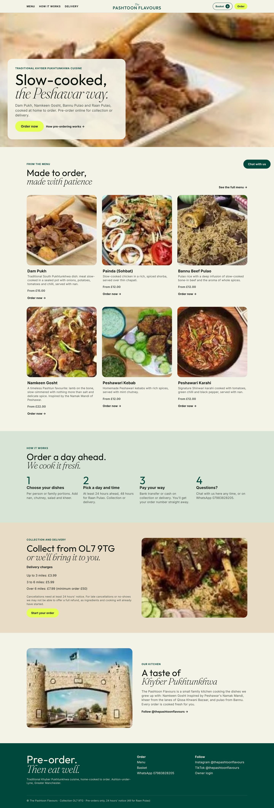

## What it does

**For customers**
- **Menu and ordering**: her real menu (Dam Pukh, Painda, Bannu Pulao, Namkeen Gosht, Kebab, Karahi, Raan Pulao, extras, Kheer) with her photos and prices. Customers add dishes to a basket, pick a date and time, and choose collection or delivery. Delivery is priced from her bands (£3.99 up to 3 miles, £5.99 for 3 to 6 miles, £7.99 over 6 miles with a £50 minimum).
- **Her rules are enforced**: 24 hours' notice (48 for Raan Pulao), cooking hours, closed days, an optional daily order limit, and the 24-hour cancellation policy.
- **Paying**: cash on collection or delivery to start. Card, Apple Pay and Google Pay through Stripe switch on as soon as a Stripe key is added, and bank transfer is one tick away in Settings.
- **Order page**: an order number and private tracking link, her own confirmation, payment and cancellation messages word for word, a Pay now button for card orders, and self-service cancellation more than 24 hours ahead.
- **Chat with us**: an AI assistant (named Zara by default) answers questions, quotes and takes orders, checks order status (order number plus phone number), and passes anything unusual to her. It always says it is an AI. Without an API key, messages go to her inbox and the customer gets a "we'll reply shortly" note.

**For her** (`/owner`, password protected)
- **Today**: today's and tomorrow's orders, alerts for new orders, payments and messages (with a chime), unpaid orders, low stock.
- **Orders**: upcoming, unpaid, past and cancelled; search; add phone orders; change status and payment; one tap to send any of her message templates on WhatsApp (confirmation, payment details, policy, ready, delay apology, thank you, review request).
- **Messages**: every customer chat. She can reply herself, pause the AI for that chat, and hand it back.
- **Calendar**: month view of orders, close or reopen days, plus a private calendar link that puts every order in Google Calendar or her iPhone calendar automatically.
- **Kitchen screen** (`/kitchen`): big tickets in To cook / Cooking / Ready columns, today or tomorrow, totals of what's still to cook, customer notes, and a chime for new orders. A private link logs a kitchen tablet in without her password.
- **Menu**: prices, portions, descriptions, notice, on/off, dish photos (upload from her phone), and recipes (ingredients for one portion) with cost and margin.
- **Stock**: purchases, write-offs with a reason (spoiled, out of date, dropped, leftover...), stock counts, low-stock warnings, history, and a shopping list for any dates worked out from upcoming orders and recipes. Starting to cook an order takes its ingredients out of stock.
- **Money**: sales, unpaid, spending, profit for this week, this month, last month or this year; best sellers; spending log.
- **Assistant**: chat with the AI to do admin ("Painda per person is now £14", "close next Friday", "I bought 5kg lamb for £45", "what's the shopping list for Saturday?").
- **Settings**: taking orders on/off, hours, daily limit, delivery bands, bank details, review link, banner message, AI on/off and name, password, new kitchen/calendar links.
- **WhatsApp, Instagram and Facebook Messenger (optional)**: the same assistant answers on Meta's apps through one webhook, `/webhook/meta`, and those chats land in Messages too. Settings shows which are connected.

## Run it

**GitHub Codespaces**: open the repository in a Codespace. It installs everything and runs `start.sh`, which prints the website address and her first password. The site runs on port 8000.

**Your own computer** (Python 3.11 or newer):

```bash
bash start.sh          # creates .env with a password, installs, starts on http://localhost:8000
```

Then open `/owner` and log in with the password the script printed. Change it in Settings.

To switch on the AI assistant, put a Claude API key from console.anthropic.com in `.env` as `ANTHROPIC_API_KEY=...` and run `bash start.sh` again. Everything else works without it.

The menu is loaded from her printed menu on the first start (no sample orders or customers). After that she edits it in the dashboard. All data lives in `data/pashtoon_site.db`.

## Tests

```bash
pip install -r requirements-dev.txt
pytest -q              # 25 tests, no network or API key needed
```

## How it fits together

```
pashtoon_site/
  web.py         routes: public site, checkout, order page, chat, owner dashboard, kitchen, calendar feed, WhatsApp webhook
  shop.py        the rules: menu, notice, slots, delivery, orders, stock and recipes, money, calendar
  agent.py       the AI assistant: customer and owner tools, prompts, chat handling and hand-over to the owner
  messages.py    her message templates, filled in for each order
  menu_data.py   her menu and default settings (first start only)
  db.py          SQLite
  geo.py         UK postcode distance (postcodes.io)
  meta.py        optional WhatsApp, Instagram and Messenger
  payments.py    optional Stripe Checkout (cards, Apple Pay, Google Pay)
  templates/, static/   pages, styles (cream, deep green, lime) and the small amount of JavaScript
```

## Meta apps (WhatsApp, Instagram, Messenger)

Everything is built; each channel switches on when its keys are in `.env` (then run `bash start.sh` again).

1. In developers.facebook.com, use (or create) a Business app and add the products you want: **WhatsApp**, **Instagram** (API with Instagram Login) and **Messenger**.
2. `.env`: `META_APP_SECRET` (App settings > Basic > App secret) and `META_VERIFY_TOKEN` (any word you choose).
3. Webhooks: callback URL `https://<site address>/webhook/meta` (shown in Settings), the same verify token. Subscribe to **messages** for WhatsApp, and **messages** for Instagram and the Facebook Page.
4. Tokens:
   - WhatsApp: `WHATSAPP_TOKEN` (a permanent system-user token) and `WHATSAPP_PHONE_ID` (WhatsApp > API Setup).
   - Instagram: `INSTAGRAM_TOKEN` for @thepashtoonflavours with the `instagram_business_manage_messages` permission.
   - Messenger: `META_PAGE_TOKEN`, a Page access token with `pages_messaging`.
5. Privacy policy URL for the app: `https://<site address>/privacy`.

In a Codespace the port must be **Public** for Meta to reach it. Until the app is published, only people added as testers can message it.

## Card payments (Stripe, Apple Pay, Google Pay)

1. Create a Stripe account for the business. In the Stripe dashboard turn on Apple Pay and Google Pay (Settings > Payment methods); Stripe's checkout page then offers them automatically.
2. `.env`: `STRIPE_SECRET_KEY` (start with the `sk_test_...` key to try it).
3. Stripe > Developers > Webhooks: add `https://<site address>/webhook/stripe` for `checkout.session.completed`, and put its signing secret in `STRIPE_WEBHOOK_SECRET`. Orders are also marked paid when the customer comes back from Stripe, but the webhook catches anyone who closes the page early.
4. Settings > Payments: "Card, Apple Pay and Google Pay" is ticked by default and appears to customers once the key is set.

No card details ever reach this site.

## Going live later

The `Dockerfile` runs the site with its data in `/data`. Any host that runs a container with a small disk works (Railway, Fly.io, a VPS). Set `PASHTOON_BASE_URL` to the real address, `SESSION_SECRET` to a long random string, `OWNER_PASSWORD`, and `ANTHROPIC_API_KEY`. Keys only ever go in `.env` or the host's settings, never in the code or a chat: `.env` is ignored by git.

## Still needed from her

- Review link and cooking hours (Settings). Bank details only if she starts taking transfers.
- Ramadan box contents and prices (add them as dishes when ready; the banner message can announce them).
- Answers to the menu questions in the original plan: Karahi portion sizes, Malai Boti and Tikka portion size, whether nan is included.
- Sharper food photos: upload them on each dish's page under Menu. The current ones are cropped from the printed menu.

## Screenshots

| | |
|---|---|
| 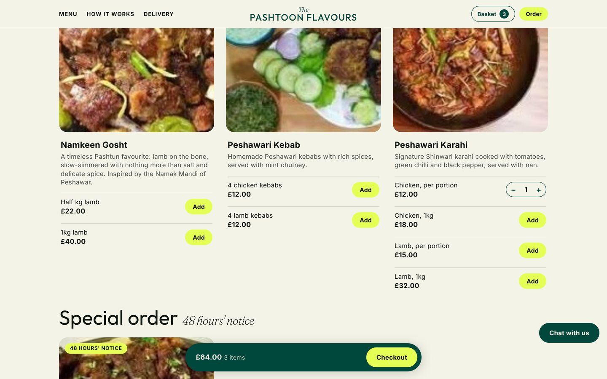 | 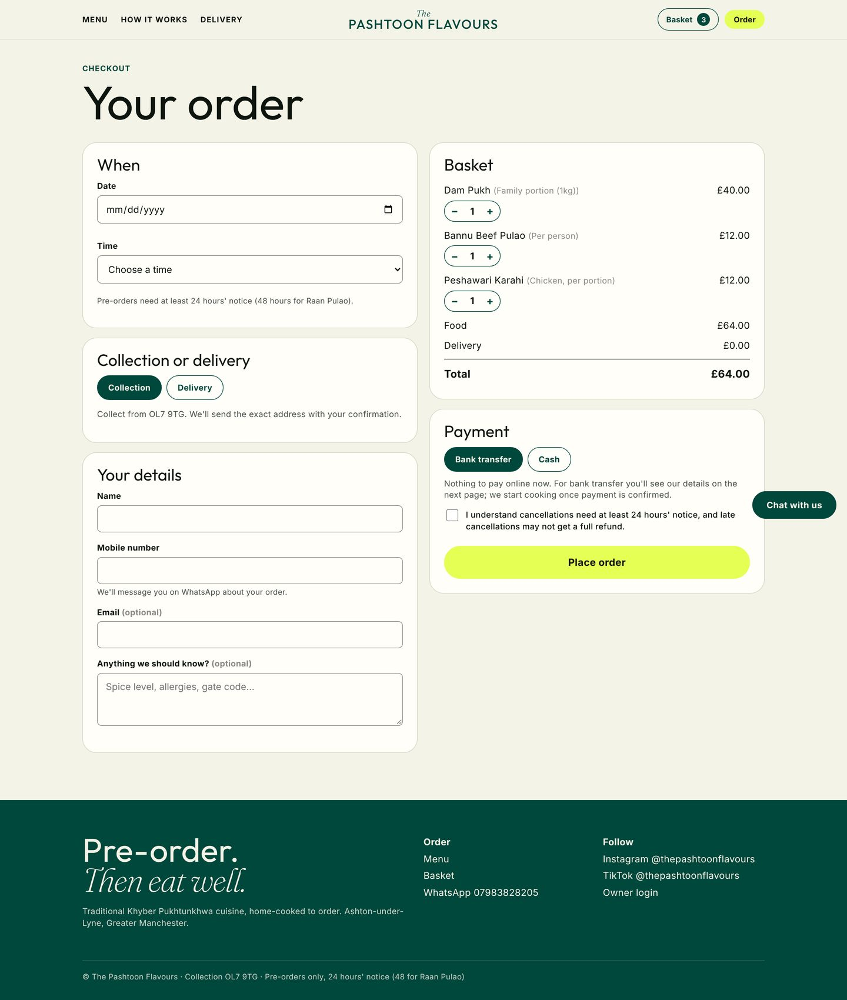 |
| 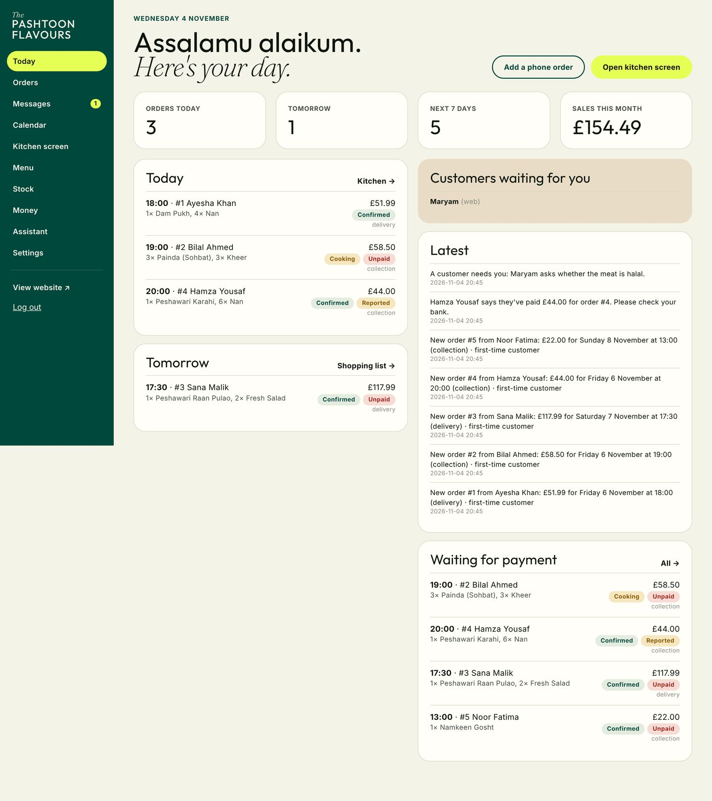 | 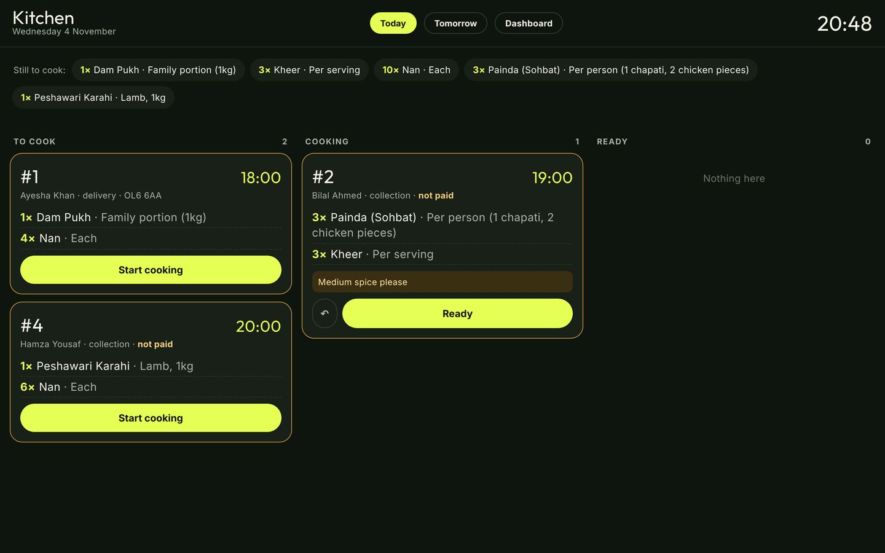 |
| 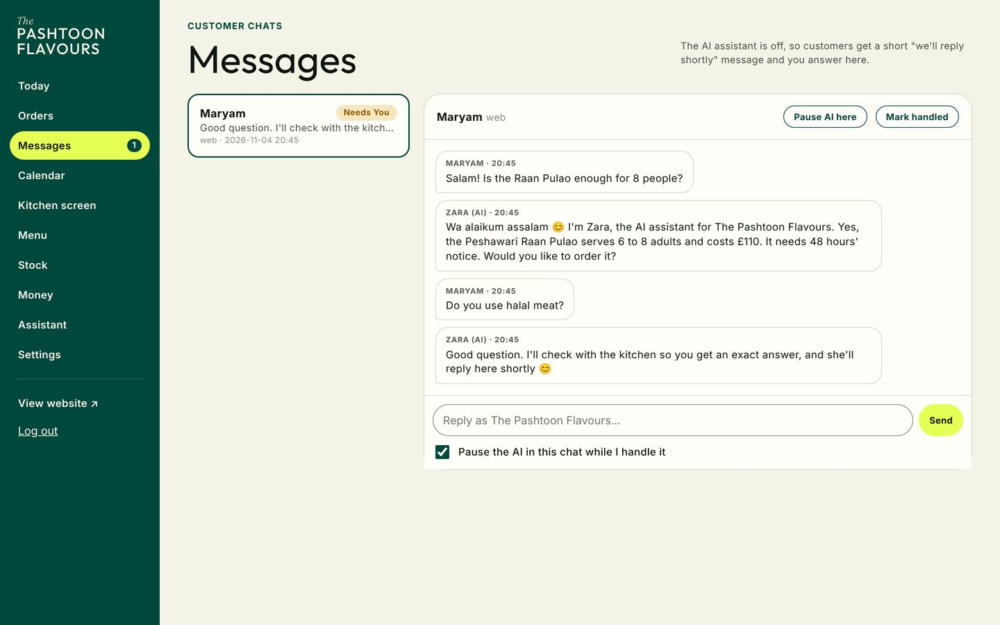 | 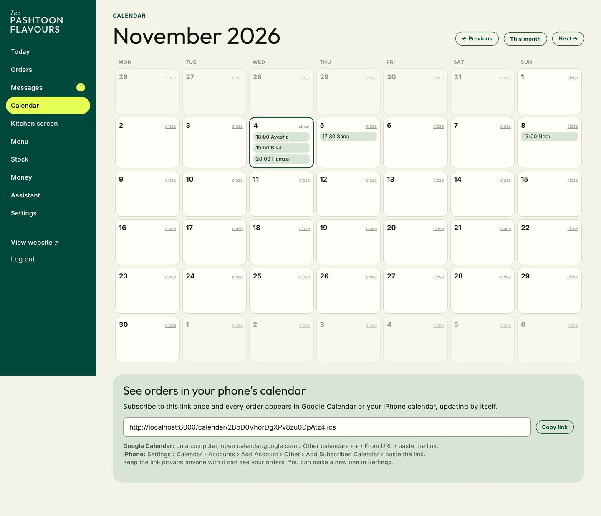 |
| 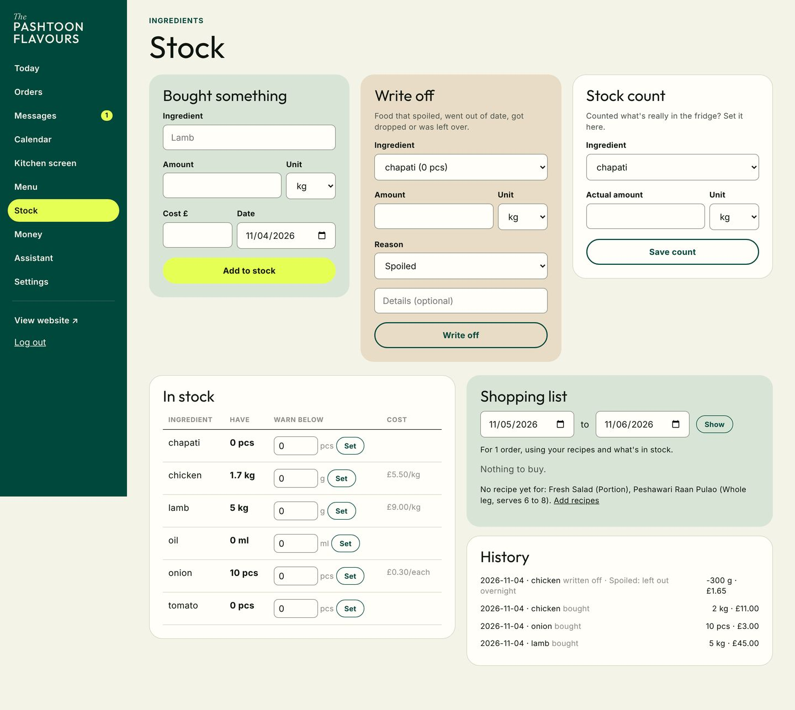 | 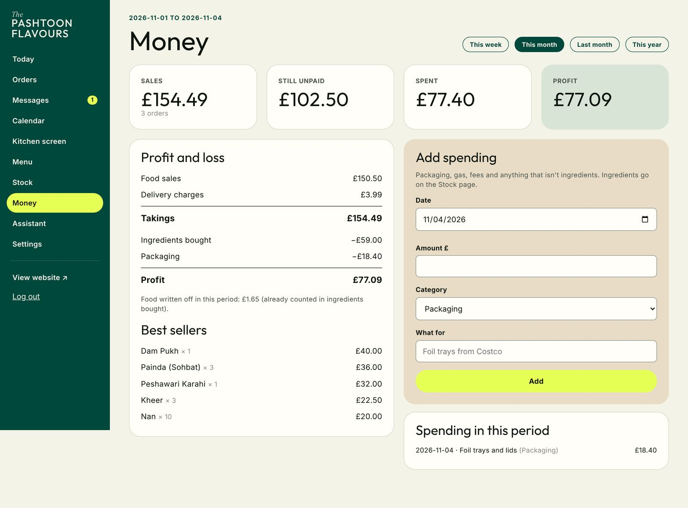 |
| 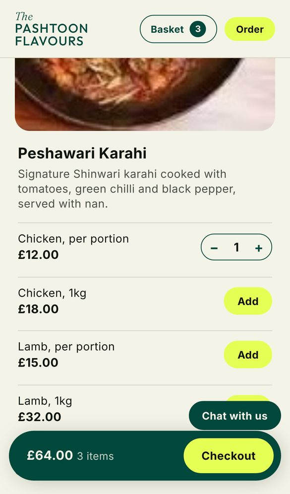 | 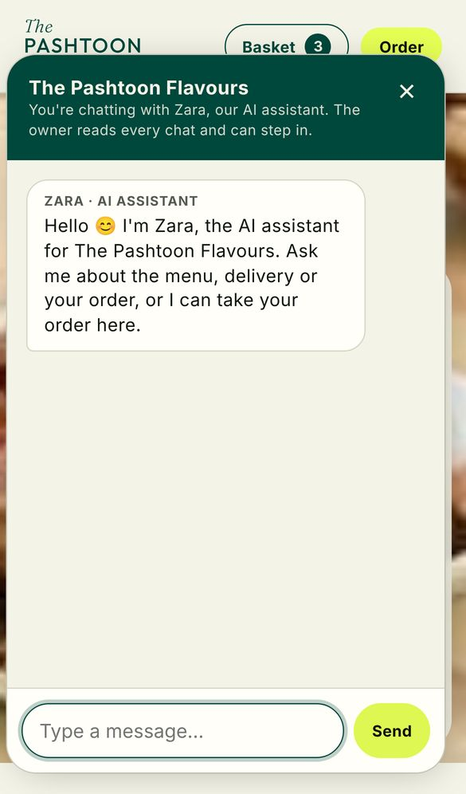 |
